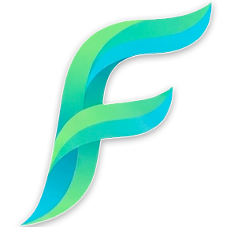
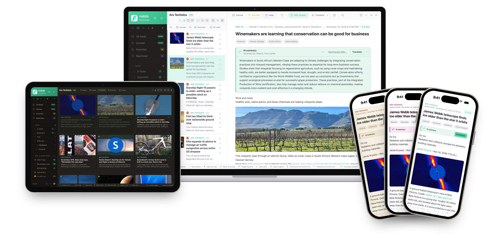
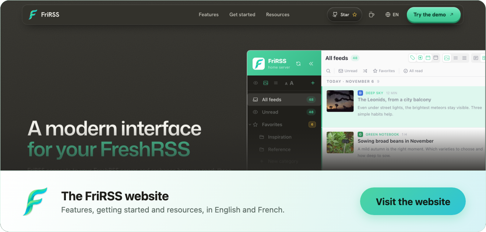
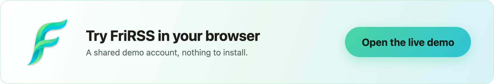

<div align="center">
  
  <h1>FriRSS</h1>
  <p><em>Your FriRSS, your rules.</em></p>
  <p>A self-hosted, customizable web frontend for <a href="https://freshrss.org">FreshRSS</a>.</p>

  <p>
    &nbsp;
    &nbsp;
    &nbsp;
    &nbsp;
    &nbsp;
    &nbsp;
    &nbsp;
    &nbsp;
    &nbsp;
    
  </p>

  <p>
    <a href="https://github.com/Fripix/Frirss/releases"></a>
    <a href="https://github.com/Fripix/Frirss/actions/workflows/ci.yml"></a>
    <a href="https://github.com/Fripix/Frirss/actions/workflows/security.yml"></a>
    <a href="LICENSE"></a>
  </p>

  <p>
    <a href="https://github.com/Fripix/Frirss/pkgs/container/frirss"></a>
    <a href="https://hub.docker.com/r/fripix/frirss"></a>
    <a href="https://ca.unraid.net/apps"></a>
    
  </p>
</div>

FriRSS is a new interface for your [FreshRSS](https://freshrss.org): FreshRSS keeps fetching and storing your feeds, FriRSS is where you read them.

> [!IMPORTANT]
> **FriRSS needs a working FreshRSS.** It is an interface only: it does not fetch feeds and cannot run on its own. Install [FreshRSS](https://freshrss.org) first, turn its API on, then [install FriRSS](#installation).

## Preview

<picture>
  <source media="(max-width: 600px)" srcset="docs/readme/preview-narrow.png">
  
</picture>

## Website

<a href="https://frirss-site.fripix.ch">
  <picture>
    <source media="(max-width: 600px)" srcset="docs/readme/website-narrow.png">
    
  </picture>
</a>

**[frirss-site.fripix.ch](https://frirss-site.fripix.ch)**

## Live demo

<a href="https://frirss.fripix.ch">
  <picture>
    <source media="(max-width: 600px)" srcset="docs/readme/live-demo-narrow.png">
    
  </picture>
</a>

**[frirss.fripix.ch](https://frirss.fripix.ch)**

> **Username** `fridemo` &nbsp;·&nbsp; **Password** `6wVQj3Q@2Qz@`

- Runs on a small server.
- Feeds cannot be added or removed, and no FreshRSS server can be connected.
- Preferences reset every 30 minutes, so themes and layout return to their defaults.
- Read state and favorites are shared with everyone else visiting.
- AI features (summaries, translations) are turned off.

The demo is there to try the interface.

## About

[FreshRSS](https://freshrss.org) has an excellent engine: solid, self-hosted, great at fetching and storing feeds. Its built-in interface just wasn't for me, and none of the alternatives fit what I wanted — so I built my own.

FriRSS sits on top of FreshRSS through its Google Reader API and replaces only the interface.

A note in the interest of honesty: this is a personal project and I'm not a developer. FriRSS was built largely by "vibe coding" — describing what I wanted to an AI assistant and iterating. Use it in that spirit.

## Features

- **Three panes on desktop, an app on your phone** — install it as a PWA, with swipe gestures and pull-to-refresh.
- **The full article**, even when a feed only sends a summary.
- **Offline reading**, images included.
- **Search that really filters** the view you are in, read articles included.
- **Mark everything as read — with *Undo*.** Nothing destructive happens in one click, and you can jump straight to the next feed with unread articles.
- **Optional AI summaries and translations** with the provider you choose, a local Ollama or a cloud one. Nothing is sent anywhere by default.
- **Three columns, two or a grid**, oldest first or at random, chosen feed by feed.
- **Keyboard first** — a command palette (<kbd>⌘K</kbd> / <kbd>Ctrl+K</kbd>) and thirteen reassignable shortcuts.
- **Make it yours** — six themes, your own colors, font and thumbnail sizes, a narrower reading column if you want one, your app name and logo.
- **Tags and sub-tags**, categories and feeds, organised from the preferences.
- **Several users, single sign-on (OIDC) and several FreshRSS servers.**
- **10 languages**, and one Docker image for amd64 and arm64.

Every feature in detail: the [website](https://frirss-site.fripix.ch/en/features/), and [`docs/FEATURES.md`](docs/FEATURES.md) (in French).

## Installation

You need:

- **a working [FreshRSS](https://freshrss.org)** — FriRSS does nothing without it — with API access on (*Settings → Authentication*) and an API password (*Settings → Profile*);
- a machine with [Docker](https://docs.docker.com/get-docker/).

FreshRSS on your home network (`192.168.x.x`, a container name)? Add `-e PROXY_INTERNAL_HOSTS=192.168.1.20` — its host or IP only — to the command below, or connecting fails.

```bash
mkdir -p frirss-data
docker run -d --name frirss \
  --restart unless-stopped \
  -p 8080:80 \
  -v "$PWD/frirss-data:/app/data" \
  -e TZ=Europe/Zurich \
  ghcr.io/fripix/frirss:latest
```

1. Open `http://localhost:8080` and create the first account — it becomes the administrator.
2. Connect your FreshRSS: its address, your FreshRSS username and the API password.

> **Install with an AI assistant.** Paste this into ChatGPT, Claude or the assistant you use. It reads [a guide written for it](docs/INSTALL-WITH-AI.md) and walks you through, one step at a time:
>
> ```
> Read https://raw.githubusercontent.com/Fripix/Frirss/main/docs/INSTALL-WITH-AI.md and help me install FriRSS step by step.
> ```

Docker Compose, Unraid, reverse proxy, updating and backups: the **[installation guide](docs/INSTALL.md)**.

## Configuration

Every setting is optional. The environment variables — time zone, user, FreshRSS on a private network, reverse proxy, Redis cache, limits — are listed by need in **[docs/CONFIGURATION.md](docs/CONFIGURATION.md)**.

## Security

FreshRSS credentials are encrypted at rest and never reach the browser; all FreshRSS traffic goes through an authenticated same-origin proxy with an anti-SSRF guard; registration is closed by default. The full list, and how to report an issue: [`SECURITY.md`](SECURITY.md).

## Feedback & Contributing

FriRSS is a personal project, but feedback, ideas and contributions are welcome.

- Found a bug, or have an idea? [Open an issue](https://github.com/Fripix/Frirss/issues/new/choose) — there are guided forms for both.
- A question, or something to talk through? [Start a discussion](https://github.com/Fripix/Frirss/discussions)
- Want to contribute code? Pull requests are welcome.
- Wondering what changed? [`CHANGELOG.md`](CHANGELOG.md)

<p align="center">
  <a href="https://buymeacoffee.com/fripix">
    
  </a>
</p>

## License

[MIT](LICENSE)
